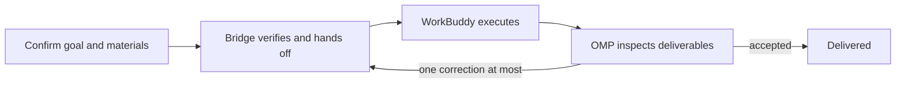

# omp-wb-bridge

[English](README.md) | [中文](README.zh-CN.md)

`omp-wb-bridge` is an OMP extension for delegating professional tasks to WorkBuddy in the same project. Keep coding, refactoring and command-line builds in OMP; use WorkBuddy for Word reports, slide decks, spreadsheet analysis, posters and similar work. OMP prepares the goal and materials, follows execution and checks the deliverables. Available capabilities depend on your WorkBuddy account, plugins and connectors.

Before delegating, prepare a project session in the WorkBuddy desktop. You may need to open it or send a message so that the desktop provides a usable ACP endpoint. The bridge attaches to these existing sessions.

## How it works



Both agents share a local project directory and exchange tasks and progress over ACP. The bridge keeps input snapshots, task-to-session associations, execution results and receipts. File deliverables go in `.wb-bridge/tasks/<taskId>/rounds/<n>/outputs/`.

WorkBuddy keeps its own models, plugins, connectors and native runtime. The shared `project_context` MCP tool reads project state; it does not dispatch work or modify the queue.

## Core capabilities

- Each new task gets a separate session that no other delegation has used. Supplements and corrections return to the same session, including after a restart.
- Tasks in different sessions can run concurrently when their file scopes are compatible. Otherwise, they queue with a stated wait reason.
- By default, OMP follows through to committed results and artifact inspection. You can explicitly choose background delivery and receive the result later.
- Review the current deliverables against the acceptance criteria, with file hashes identifying the reviewed version. Each task allows at most one automatic correction; changed files need a new review.
- Task submission and native-step permissions require separate confirmation. The model cannot approve either; dismissed, timed-out or unparseable permission requests are refused.
- The bridge does not persist connection credentials, environment secrets, raw conversations or model reasoning.
- Failures preserve partial artifacts and known results. Work that may already have been sent is not replayed automatically. Repairing a receipt and releasing an execution quarantine are separate operations.

## Installation

### Prerequisites

- Bun 1.4+
- OMP 18.10.3+
- A local WorkBuddy desktop app that can expose a local ACP endpoint
- Native sessions the user prepared in the WorkBuddy desktop for the project, with the desktop serving them

### User-level installation

Run these commands in a terminal to preview the installation location and configuration changes:

```bash
git clone https://github.com/gongquan45/omp-workbuddy-bridge.git
cd omp-workbuddy-bridge
bun install

bun src/install.ts --preview
```

Apply only after reviewing and accepting the preview:

```bash
bun src/install.ts --apply
```

The installer creates or reuses a stable release directory, installs dependencies, registers the OMP plugin and configures the bridge entry in `~/.workbuddy/mcp.json`. It does not overwrite a conflicting configuration file. Check both registration and configuration results in the report; partial success is not a completed installation.

The installer does not restart programs. Restart OMP, open a session in the target project and check the plugin path actually loaded. Use `bun src/install.ts --help` for custom directory options.

### Development or temporary loading

For development, load the local source package directly:

```bash
cd /path/to/omp-wb-bridge
bun install

omp --cwd /path/to/your/project -e /path/to/omp-wb-bridge
```

Pass the absolute package directory to `-e`, not just `src/index.ts`, so OMP can discover the packaged skill. For persistent source loading, append that directory to the existing OMP `extensions` list, preserve other entries and restart OMP. If a release is already installed, do not load another source entry point alongside it.

## Installation steps for an agent

You can give an agent the following instructions:

```text
Install and enable omp-wb-bridge:

1. Check that Bun 1.4+, OMP 18.10.3+ and the WorkBuddy desktop are available.
   Report missing prerequisites; do not install or upgrade those programs without permission.
2. In the source checkout, run bun install, then bun src/install.ts --preview.
   Show the release directory, configuration files and proposed changes.
   Run --apply only after the user explicitly approves them.
3. Check the installation report, ask the user to restart OMP and verify the
   release directory actually loaded. Do not also load a source entry point
   through -e or extensions.
4. Ask the user to open the target project in the WorkBuddy desktop and prepare
   a native session, activating it manually if needed.
   In that project's OMP session, run /wb setup, then /wb bind if not yet bound.
   Configuration and binding confirmations belong to the user; do not approve them.
5. Use /wb status and /wb doctor to check the session pool, paths and blockers.
   /wb doctor uses HTTP probes only, not an ACP handshake; a successful diagnosis
   does not mean a task has executed.
   Do not send test tasks or run live-smoke by default. Never approve native permissions yourself.
```

## Usage

1. In the WorkBuddy desktop, open the project folder as a workspace and start a native session for the work you want to hand over, then confirm the desktop is serving it. Prepare as many sessions as you intend to run concurrently.
2. In OMP, run `/wb setup`. It previews what it will write, and only after a human confirms does it write the `omp-wb-bridge` entry in `~/.workbuddy/mcp.json` and initialize the project state. If the project is not bound yet, it also asks whether to enroll the sessions it found on the desktop.
3. If nothing is bound yet, run `/wb bind` to bind the project to a verified session roster. Sessions opened later for the same project join the roster automatically; no second binding is needed.
4. Say what you want in natural language, for example "use WorkBuddy to produce a quarterly analysis of the sales data, output xlsx", or "have WorkBuddy make a poster".
5. OMP dispatches the task, follows the execution, then opens the real files and checks them. You get the result only after it passes review.

For formats both agents can handle, such as `.docx`, `.pdf`, `.md`, `.csv` and `.xlsx`, use the prompt to choose WorkBuddy or OMP. Choosing the executor does not approve the task or any native-step permission.

If a session is busy or offline, check the wait reason first. If every context is assigned to another task, open a new same-project session in the desktop. Project binding persists, and new sessions are enrolled automatically. If execution is unknown, do not submit again or bypass quarantine by clearing state or switching sessions.

ACP endpoints open on demand and may be reclaimed when a worker rotates or the desktop restarts; the project binding persists. If you see `WB_SESSION_NOT_RUNNING`, first open or activate the original session in the desktop, then check its endpoint state. Do not rebind or submit the task again solely because of this error.

## Commands and tools

### `/wb` commands

| Command | Purpose |
|---|---|
| `/wb` | Open the workbench (prints the same information when there is no UI). |
| `/wb status` | Read-only: the project session pool, desktop health, and the tasks running in this process. |
| `/wb setup` | Preview and write the single global WorkBuddy MCP entry, and enable the project state. A foreign or malformed entry under the same name makes it refuse the whole change. |
| `/wb init` | Migrate and enable the project state without touching configuration. |
| `/wb bind` | Confirm and save the project binding, enrolling its verified WorkBuddy sessions. |
| `/wb send <requestId>` | Confirm and submit the frozen draft that `wb_task` reported in a headless session. |
| `/wb tasks [task]` | List this project's tasks, or show one task in detail. |
| `/wb background <task>` | After an explicit human choice, switch one task's current round to background delivery. |
| `/wb results [task]` | Show this OMP session's unconsumed results and the current file states. |
| `/wb repair [task]` | Rebuild a failed receipt from the result already recorded in the queue. Sends nothing, and does not prove the WorkBuddy turn ended. |
| `/wb cancel [task]` | Cancel a task owned by this OMP process. Tasks owned by another process or another person are left alone. |
| `/wb release [task]` | Release one quarantined execution after a human records how it was seen to stop and confirms again. |
| `/wb doctor` | Read-only diagnosis of the binding, the queue, storage and desktop health. |
| `/wb usage` | Print the command reference. |

### OMP host tools

| Tool | Purpose |
|---|---|
| `wb_task` | Submit a delegation round with an objective and checkable acceptance criteria. A human confirms before dispatch; external side effects get their own point-of-risk confirmation. |
| `wb_status` | Read a task's state and its verified artifacts. It waits for the durable commit, not for the desktop's verbal promise. |
| `wb_review` | Record the reviewer's own verdict on each acceptance criterion, bound to the current file hashes. A `changes_requested` verdict starts the task's single automatic correction. |
| `wb_cancel` | Cancel an active task owned by this process. |
| `wb_tasks` | Paginated listing of persisted rounds. Strictly read-only. |
| `wb_doctor` | Read-only inspection of the binding, queue holds and desktop health. |

### Read-only MCP tool

`project_context` (`src/mcp.ts`) reads queued work, scope allocations, deliverables and review verdicts. It exposes no MCP write tools.

### Packaged skill

- [Delegation skill](skills/workbuddy-delegate/SKILL.md): OMP's delegation, follow-through and review workflow.
- [Native capability reference](skills/workbuddy-delegate/references/native-capabilities.md): input and acceptance examples.
- [Live acceptance runbook](skills/workbuddy-delegate/references/live-smoke.md): requires separate authorization; not for ordinary tasks.

## Development

```bash
bun install
bun test
bun run typecheck
```

`bun test` runs the offline behavioural tests, and `bun run typecheck` runs `tsc --noEmit`. There is no build step; OMP loads the TypeScript source directly.

## License

This repository has no `LICENSE` file or `license` field in `package.json`. Confirm the terms with the author before using, modifying or redistributing the code.
