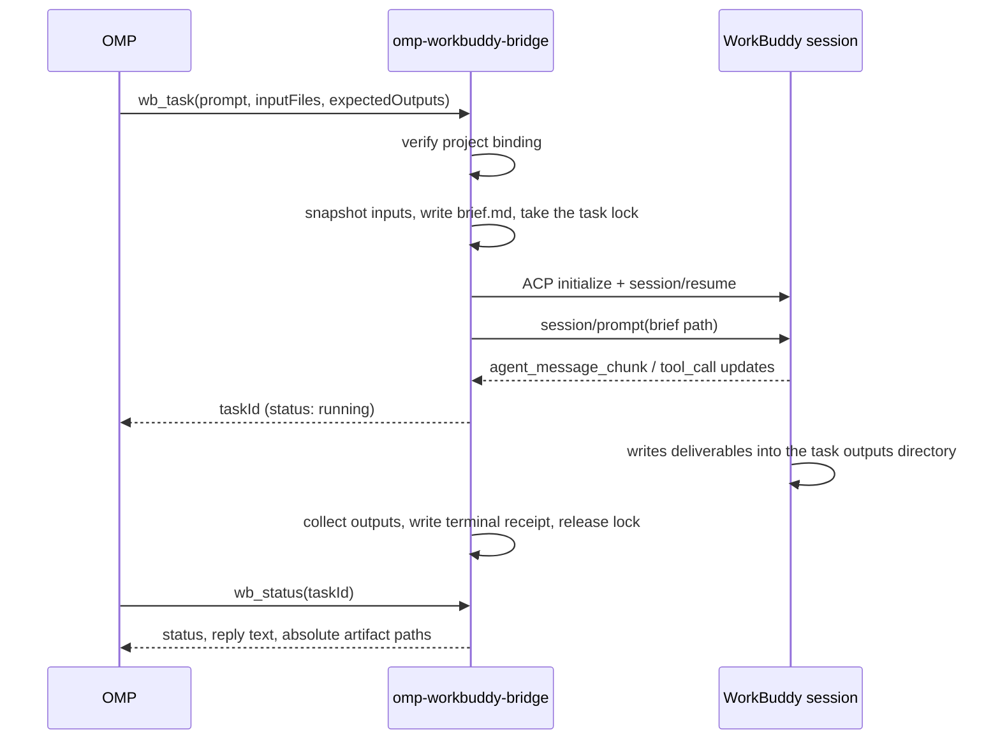

# omp-workbuddy-bridge

An OMP-native extension that delegates one self-contained task at a time —
research, office documents, design — to a **WorkBuddy desktop session**, and
brings back the real reply plus the files it produced.

OMP stays the orchestrator. WorkBuddy stays the specialist executor, using its
own native skills, plugins and permissions. Nothing is faked in between: the
extension attaches to a live WorkBuddy ACP session over HTTP, sends a task
brief, streams the session's events, and collects the deliverables that landed
on disk.

## What it registers

| Registration | Purpose |
| --- | --- |
| `/wb bind` | Attach this project to one WorkBuddy session, chosen explicitly from verified candidates. |
| `/wb status` | Show the binding, whether its worker is live, and the tasks this OMP session owns. |
| `wb_task` | Delegate a task. Returns a `taskId` immediately; the turn keeps running. |
| `wb_status` | Read a task's status, reply text and artifact paths; optionally wait briefly for a change. |
| `wb_cancel` | Cancel one task this OMP process owns. Never touches the worker or other sessions. |
| `wb_tasks` | List this project's persisted tasks, newest first, with status filtering and paging. Read-only. |
| `wb_doctor` | Diagnose the binding, task lock and bound worker without changing anything. Read-only. |

Alongside the tools, the package ships a `workbuddy-delegate` skill
(`skills/workbuddy-delegate/SKILL.md`) describing the delegation workflow and
`skills/workbuddy-delegate/references/live-smoke.md` for maintainer acceptance.
The skill is discovered when the **package directory** is loaded:

```bash
omp --cwd /path/to/your/project --no-extensions -e /path/to/omp-workbuddy-bridge
```

Loading the file entrypoint (`…/src/index.ts`) registers the same tools but has no
sibling `skills/` directory to scan, so this skill is not discovered in that mode.

## How a task flows



A task only counts as `completed` when WorkBuddy stops with `end_turn` **and**
every declared `expectedOutputs` file exists. Anything else is reported honestly:
`WB_OUTPUT_MISSING`, `WB_TASK_FAILED`, or `WB_INTERRUPTED`.

## Layout it creates

Everything lives under the project, never in your source tree:

```text
.wb-bridge/
  binding.json                    the chosen WorkBuddy session
  active.lock                     one task at a time, per project
  tasks/<taskId>/
    brief.md                      the instruction handed to WorkBuddy
    inputs/                       snapshot of the caller's input files
    outputs/                      where WorkBuddy must write deliverables
    receipt.json                  durable task record
```

## Requirements

- **Bun** 1.4+ and a WorkBuddy desktop installation.
- A WorkBuddy session **dedicated to OMP delegation**, created and authorized in
  the desktop app for the same folder OMP runs in. The extension attaches to that
  session; it never creates sessions, never spawns a CLI, and never picks a
  session for you.
- WorkBuddy must expose ACP for that session. If the desktop app is actively
  driving the session, attachment is reported as `WB_BUSY` and can be retried
  once the app lets go.

## Install

```bash
bun install
bun test
bun run typecheck
```

Then load it explicitly in OMP:

```bash
omp --cwd /path/to/your/project -e /path/to/omp-workbuddy-bridge/src/index.ts
```

To load it every session, add the entry point to the `extensions` array in your
OMP config.

## Safety properties

- Only loopback `http://127.0.0.1:<port>` endpoints without embedded credentials
  are ever contacted.
- A permission request is **never** auto-approved. Only an explicit one-time
  human choice returns `allow`; dismissing the dialog, a headless session, an
  aborted task, or an unrendorable request all fail closed, and no standing
  allowance is ever offered. If the task stops while a dialog is open, a late
  "Approve once" is refused.
- No secrets, environment values, chat history or model reasoning are written to
  disk; the connection id and session token live in memory only.
- Cancelling or shutting down touches one task's connection, never the WorkBuddy
  process, its session, or another session.
- Task inputs are restricted to real files inside the project; outputs are
  restricted to the task's own `outputs/` directory.
- A task's terminal receipt is committed **before** its lock is released. If
  either the receipt write or the release fails, the task reports
  `WB_STORAGE_ERROR` alongside the worker's own outcome, the lock is left in
  place rather than freed on an unproven write, and the failure is never disguised
  as a success. Fix the storage problem, then restart OMP; the next delegation
  safely reclaims an orphaned slot after recording it as interrupted.
- `wb_tasks` and `wb_doctor` never write: they read the stored index and the
  binding, and contact a worker only through its three documented GET endpoints.
  Neither one creates a directory, repairs or deletes a lock, changes the binding,
  or requests an approval. `wb_doctor` cannot prove ACP compatibility — that is
  only ever proven when a real delegation connects. Endpoints it cannot identify
  are summarised in one finding rather than one warning per socket, so unrelated
  WorkBuddy services cannot bury the real result.

## Versioning and releases

- **Semantic versioning:** The package adheres to SemVer. Backward-compatible bug fixes increment the patch version; backward-compatible additions of tools, optional parameters, or fields increment the minor version; breaking changes that remove or rename user-facing tools, parameters, or fields or alter behavior requiring caller migration increment the major version. Bumping version is determined by external behavior, not file counts or commit categories.
- **Branch and commit conventions:** The `main` branch is kept runnable. Short-lived working branches use `feat/<topic>`, `fix/<topic>`, or `chore/<topic>`. Commits follow conventional format `type(scope): summary` (with optional scope), where type is `feat`, `fix`, `docs`, `test`, `refactor`, or `chore`, scoped to small, independently revertible units.
- **Release workflow:**
  1. Complete and verify changes locally.
  2. Update `version` in `package.json` and the corresponding section and date in `CHANGELOG.md`.
  3. Verify runtime and types: `bun test` and `bun run typecheck`.
  4. If native or lifecycle behavior has changed, execute human acceptance testing following the live-smoke runbook in `skills/workbuddy-delegate/references/live-smoke.md`.
  5. Review and commit changes.
  6. Create a unique annotated git tag: `git tag -a v<package-version> -m "omp-workbuddy-bridge <package-version>"`.
  7. Push `main` and the annotated tag to the remote repository. Tags are never reused, moved, or force-pushed.
- **Runtime metadata:** Version metadata is read from `package.json` at module load time. When upgrading, start a new OMP session once active delegations are completed to load the new version.
- **Separation of concerns:** The package product version, ACP protocol version, filesystem storage schema, and WorkBuddy desktop version are maintained independently. Public source publication preserves `"private": true`; there is no automated npm publishing, CI pipeline, or GitHub Release artifact workflow configured.
