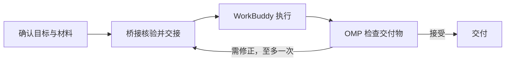

# omp-wb-bridge

[English](README.md) | [中文](README.zh-CN.md)

`omp-wb-bridge` 是一个 OMP 扩展，用来把同一项目中的专业任务交给 WorkBuddy。工程编码、重构和命令行构建留在 OMP；Word 报告、PPT、表格分析、海报等工作可以交给 WorkBuddy。OMP 准备目标和材料，跟进执行，并检查交付成果。具体能力取决于 WorkBuddy 的账号、插件和连接器配置。

使用前需要在 WorkBuddy 桌面准备好项目会话，必要时打开会话或发送一条消息，让桌面端提供可用的 ACP 入口。桥接只连接这些既有会话。

## 原理



两端共用本地项目目录，通过 ACP 交接任务与进度。桥接保存输入快照、任务与会话的关联、执行结果和收据；文件交付物放在 `.wb-bridge/tasks/<taskId>/rounds/<n>/outputs/`。

WorkBuddy 保留自己的模型、插件、连接器和原生运行环境。共享的 `project_context` MCP 工具只读项目状态，不参与派发或修改队列。

## 核心功能

- 每个新任务使用独立、未被其他委派用过的会话；补充与修正回原会话，重启后仍保留关联。
- 不同会话、文件范围兼容的任务可并行。没有合适会话时排队，并说明等待原因。
- 默认跟进到结果提交和成果检查；用户也可明确选择后台执行，稍后接收结果。
- 按验收条件检查当前成果，用文件哈希关联评审版本。每个任务至多自动修正一次，文件变化后需重新验收。
- 任务提交与原生步骤权限分别确认，模型不能自行批准。关闭权限弹窗、超时或无法解析时拒绝放行。
- 桥接不持久化连接凭据、环境秘密、完整对话或模型推理。
- 失败时保留部分成果和已知结果。可能已发送的工作不自动重发；修复收据与解除执行隔离是两项独立操作。

## 安装指南

### 前置条件

- Bun 1.4+
- OMP 18.10.3+
- 本机装有 WorkBuddy 桌面端，并且它能暴露本地 ACP 端点
- 用户在 WorkBuddy 桌面为该项目准备好原生会话，桌面正在服务它们

### 安装到用户目录

在终端运行以下命令，先查看安装位置和配置改动：

```bash
git clone https://github.com/gongquan45/omp-workbuddy-bridge.git
cd omp-workbuddy-bridge
bun install

bun src/install.ts --preview
```

确认预览内容后再应用：

```bash
bun src/install.ts --apply
```

安装器会创建或复用稳定发行目录、安装依赖、注册 OMP 插件，并配置 `~/.workbuddy/mcp.json` 中的桥接条目。配置冲突时不会覆盖原文件；请查看报告中的注册与配置结果，不要把部分成功当成安装完成。

安装器不会自动重启程序。重启 OMP，并在目标项目中打开新会话后，确认实际加载的插件路径。需要自定义目录时，可用 `bun src/install.ts --help` 查看参数。

### 开发或临时加载

开发时可以直接加载本地源码包：

```bash
cd /path/to/omp-wb-bridge
bun install

omp --cwd /path/to/your/project -e /path/to/omp-wb-bridge
```

`-e` 后使用包目录的绝对路径，不要只指向 `src/index.ts`，否则配套 Skill 无法被完整发现。需要持久加载源码时，可将包目录追加到 OMP 现有的 `extensions` 列表，保留其他条目并重启 OMP。已安装发行目录时，不要再加载一份源码入口。

## 给 Agent 的安装步骤

可将下面的要求交给 Agent：

```text
请安装并启用 omp-wb-bridge：

1. 核对 Bun 1.4+、OMP 18.10.3+ 和 WorkBuddy 桌面端是否可用。
   缺少前置条件就报告，不擅自安装或升级这些程序。
2. 在源码仓库目录运行 bun install，然后运行 bun src/install.ts --preview。
   展示发行目录、配置文件和拟写入内容，取得用户明确同意后再运行 --apply。
3. 检查安装报告，请用户重启 OMP，并核对实际加载的发行目录。
   不要再通过 -e 或 extensions 重复加载另一份源码入口。
4. 请用户在 WorkBuddy 桌面打开目标项目并准备原生会话，必要时手工激活。
   在该项目的 OMP 会话中运行 /wb setup；尚未绑定时再运行 /wb bind。
   涉及配置和绑定的确认由用户完成，不替用户选择批准。
5. 用 /wb status 和 /wb doctor 核对会话池、路径和阻塞原因。
   /wb doctor 只做 HTTP 探测，不做 ACP 握手；诊断成功不代表任务已执行。
   不默认发测试任务，不运行 live-smoke，也不自行批准原生权限。
```

## 如何使用

1. 在 WorkBuddy 桌面把项目目录作为工作区打开，为要交出去的工作开一个原生会话，确认桌面正在服务它。要并行几个任务就准备几个会话。
2. 在 OMP 里执行 `/wb setup`。它先预览要写什么，人确认后才写 `~/.workbuddy/mcp.json` 的 `omp-wb-bridge` 条目，并初始化项目状态；项目还没绑定时，它会问要不要顺便纳入桌面上找到的会话。
3. 还没绑定就执行 `/wb bind`，把项目绑到一个已核验的会话名册上。之后新开的同项目会话自动进名册，不用重绑。
4. 用自然语言说要什么，比如“用 WorkBuddy 做一份销售数据的季度分析，输出 xlsx”，或者“让 WorkBuddy 出一版海报”。
5. OMP 派出任务、跟进执行，然后打开真实文件检查，验收通过才把成果交给你。

对 `.docx`、`.pdf`、`.md`、`.csv`、`.xlsx` 等双方都能处理的格式，按提示选择交给 WorkBuddy 还是留在 OMP。选择执行方不等于批准任务或原生步骤权限。

会话忙碌或离线时，先查看等待原因；上下文都已分配给其他任务时，需要在桌面另开同项目会话。项目绑定会保留，新会话会自动纳入。执行状态未知时不要重复提交，也不要通过清理状态或切换会话绕过隔离。

ACP 端点按需开启，worker 轮换或桌面重启后可能被回收，项目绑定则会保留。出现 `WB_SESSION_NOT_RUNNING` 时，先在桌面打开或激活原会话，再核对入口状态；不要仅因这个错误重新绑定或重复发任务。

## 命令与工具

### `/wb` 命令

| 命令 | 用途 |
|---|---|
| `/wb` | 打开工作台；没有界面时打印同样的信息。 |
| `/wb status` | 只读：项目会话池、桌面端健康度、本进程正在跑的任务。 |
| `/wb setup` | 预览并写入唯一的全局 WorkBuddy MCP 条目，同时启用项目状态。文件里有外来或损坏的同名条目就整个拒绝。 |
| `/wb init` | 迁移并启用项目状态，不动配置。 |
| `/wb bind` | 确认并保存项目绑定，纳入该项目通过核验的 WB 会话。 |
| `/wb send <requestId>` | 确认并提交无界面会话下 `wb_task` 报告过的冻结草稿。 |
| `/wb tasks [task]` | 列出本项目任务，或看单个任务详情。 |
| `/wb background <task>` | 人明确选择后，把某个任务的当前轮次改成后台回报。 |
| `/wb results [task]` | 查看本 OMP 会话还没消费的结果和当前文件状态。 |
| `/wb repair [task]` | 依据队列已记录的结果重建失败收据。不重发，也不证明 WorkBuddy 那轮已经结束。 |
| `/wb cancel [task]` | 取消本 OMP 进程拥有的任务。别的进程或别人的任务不动。 |
| `/wb release [task]` | 人写下结束依据并再次确认后，释放一个隔离中的执行现场。 |
| `/wb doctor` | 只读诊断绑定、队列、存储和桌面端健康度。 |
| `/wb usage` | 打印命令参考。 |

### OMP 宿主工具

| 工具 | 用途 |
|---|---|
| `wb_task` | 提交一轮委派，含目标和可核验的验收条件。派发前要人确认；有外部副作用时另做一次风险点确认。 |
| `wb_status` | 读任务状态和已核验成果，等的是持久提交，不是桌面端的口头承诺。 |
| `wb_review` | 记录评审者自己对每条验收标准的结论，绑定当前文件哈希。`changes_requested` 会启动该任务唯一一次自动修正。 |
| `wb_cancel` | 取消本进程拥有的活动任务。 |
| `wb_tasks` | 分页列出已持久化的轮次，严格只读。 |
| `wb_doctor` | 只读检查绑定、队列占用和桌面端健康度。 |

### 只读 MCP 工具

`project_context`（`src/mcp.ts`）只读队列中的工作、范围占用、交付物和评审结论，不提供 MCP 写入工具。

### 随包技能

- [委派 Skill](skills/workbuddy-delegate/SKILL.md)：OMP 的委派、跟进与验收流程。
- [原生能力参考](skills/workbuddy-delegate/references/native-capabilities.md)：输入与验收示例。
- [现场验收手册](skills/workbuddy-delegate/references/live-smoke.md)：需要单独授权，不作为日常任务执行。

## 开发

```bash
bun install
bun test
bun run typecheck
```

`bun test` 是离线行为测试，`bun run typecheck` 是 `tsc --noEmit`。项目没有构建步骤，OMP 直接加载 TypeScript 源码。

## 开源协议

本仓库尚未提供 `LICENSE` 文件，`package.json` 也未声明 `license`。使用、修改或再分发前，请先向作者确认授权条款。
