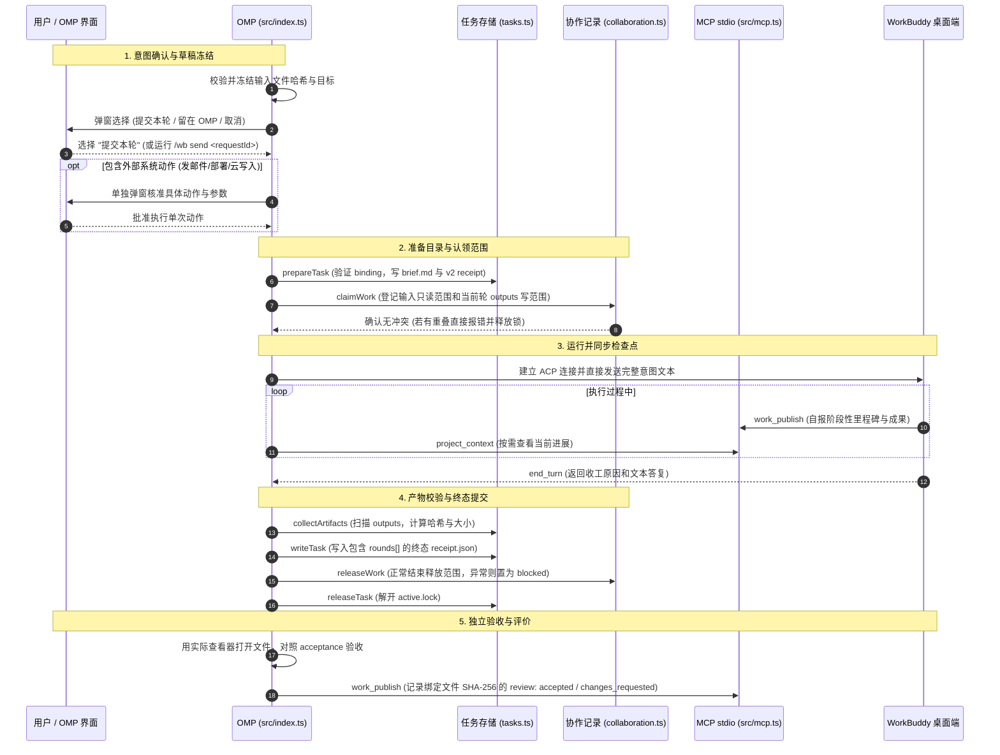

# omp-wb-bridge

[English](README.md) | [中文](README.zh-CN.md)

`omp-wb-bridge` 是一个连接 OMP 和 WorkBuddy 桌面端会话的原生扩展。

分工很简单：工程编码、代码重构、命令行工具留在 OMP 里做；写 Word 报告、做 PPT 幻灯片、复杂数据分析、生成海报视频这些偏办公和设计的事，交由 WorkBuddy 桌面端跑。在 WorkBuddy 里直接发起的工作，也可以同步回 OMP 并在终端里直接验收和集成。

两端共用一套本地文件存储和三个基于 stdio 的 MCP 工具。没有后台常驻守护进程，不额外加一层任务规划器，也不搞私有记忆系统。

---

## 提供的命令与工具

### 1. 终端管理命令 (`/wb`)

| 命令 | 用途 |
|---|---|
| `/wb bind` | 选择并绑定当前项目到 WorkBuddy 桌面端的专用会话。 |
| `/wb status` | 查看绑定会话状态、桌面端进程健康度以及当前正在运行的任务。 |
| `/wb send <requestId>` | 确认并发送暂存的目标草稿（供没有图形界面的终端使用）。 |
| `/wb release <workId>` | 显式解除意外残留或阻断的文件范围锁。 |
| `/wb setup` | 一键配置 OMP（`.omp/mcp.json`）与 WorkBuddy（`~/.workbuddy/mcp.json`）的 MCP 连接，并同步协作技能。 |

### 2. OMP 工具箱

| 工具 | 用途 |
|---|---|
| `wb_task` | 发起任务委派。需要明确传入意图（`objective`）和验收指标（`acceptance`）。提交前会弹窗让用户选择确认；若涉及发邮件、部署等外部副作用，会单独要求二次确认。 |
| `wb_status` | 轮询任务状态、当前轮次回合回复和产物文件列表（包含文件类型、实际大小及 SHA-256 哈希）。 |
| `wb_cancel` | 取消由当前进程发起的任务。会先等桌面端收尾确认后再切断连接，避免下次调用排队卡死。 |
| `wb_tasks` | 分页查看历史委派任务列表，按修改时间倒序排列。只读操作。 |
| `wb_doctor` | 检查绑定配置、本地锁和桌面端健康接口，不修改任何文件。 |

### 3. 双端共享 MCP 工具 (`src/mcp.ts`)

启动方式为普通 stdio 进程（`bun src/mcp.ts --project <项目根路径> --agent <omp|workbuddy>`），提供三项工具：

| MCP 工具 | 用途 |
|---|---|
| `project_context` | 查询项目内各任务的活跃状态、持有的文件路径、阶段里程碑和审查结论。 |
| `work_claim` | 在开始干活前声明自己要读写的文件目录范围，防止两边同时改动重叠的文件。 |
| `work_publish` | 登记关键里程碑、交付物清单，或给对方的产物写审查意见（包含实测哈希核对）。 |

### 4. 配套技能 (Skills)

- **`skills/omp-wb-collaboration/SKILL.md`**：两端通用的协作约定（动手前先查范围、动文件先认领、产出算哈希、用完即释放）。
- **`skills/workbuddy-delegate/SKILL.md`**：指导 OMP 何时该自己做、何时建议委派给 WorkBuddy，以及如何写出合格的验收条件。
- **`skills/workbuddy-delegate/references/native-capabilities.md`**：整理了 19 种原生专业场景（写报告、改 PPT、生成图表、日常开发、定时计划等）的具体输入和最低验收底线。
- **自动发现**：已接入 OMP 原生 `resources_discover`，无论通过包目录加载还是 `-e src/index.ts` 单文件加载，两项技能都能被 OMP 正常识别。

---

## 协作与执行流程



---

## 磁盘目录结构

所有生成的运行时文件都在项目根目录下的 `.wb-bridge/` 中，不污染项目源码树：

```text
.wb-bridge/
  binding.json                      绑定的 WorkBuddy 会话标识
  active.lock                       项目当前的活动任务锁（一次只能跑一个委派任务）
  collaboration.lock                协作记录短锁（仅在原子写协作元数据时极短时间持有）
  collaboration/
    <workId>.json                   OMP 与 WorkBuddy 登记的双端工作记录
  tasks/<taskId>/
    receipt.json                    v2 格式任务收据，保存完整的 rounds[] 轮次数组
    rounds/<roundNumber>/
      brief.md                      当前轮次交底说明
      inputs/                       当前轮次拷入的输入文件快照
      outputs/                      当前轮次 WorkBuddy 产出的交付文件
  workbuddy/<workId>/
    outputs/                        WorkBuddy 原生任务的独立产出目录
```

---

## 安全规则

1. **提交前强制确认**：
   - 模型工具不能给自己授权。传 `approved: true` 或在自然语言里说“用户同意了”都会被直接忽略。
   - 目标一旦冻结，在确认期间如果输入文件被外部修改，由于 SHA-256 对不上，任务会拒绝发送并要求重新确认。
   - 涉及发外部网络请求、云端写操作或定时计划的，必须经由独立弹窗逐项核对具体操作和参数。
2. **权限阻断策略**：
   - 桌面端发来的敏感权限请求，只有人主动选“允许单次”才会放行。无 UI 环境、关闭弹窗、超时或格式无法识别均直接拒绝。
3. **文件范围互斥**：
   - 文件锁检查按具体路径树层级进行。一个任务声明了写某个目录，另一个任务去读写该目录及其子目录都会触发 `WB_SCOPE_CONFLICT`。
4. **真实文件与哈希绑定**：
   - `completed` 仅代表对面正常结束且文件写下了，不等于内容合格。
   - 验收评价必须实测文件的 SHA-256。如果文件发布后被改动过，提交评价时会直接抛出 `WB_ARTIFACT_CHANGED`。
5. **配置文件保护 (`/wb setup`)**：
   - 读取 `.omp/mcp.json` 或 `~/.workbuddy/mcp.json` 时，只有 `ENOENT`（文件不存在）才会新建最小配置。
   - 遇到语法错误、JSON 根非对象、或者已被外来程序占用的同名服务项时，直接停止并报错，原文件保留逐字节不变，绝不覆盖清除。
6. **无凭据落地**：
   - 连接令牌、环境变量、模型内部思考过程（`agent_thought_chunk`）和完整对话历史均不存盘。

---

## 开发与测试

### 环境要求
- **Bun 1.4+**
- 本地安装并打开了 ACP 协议支持的 WorkBuddy 桌面端（5.8.2+）。

### 测试命令
```bash
bun install
bun test
bun run typecheck
```

- `bun test`：执行包括任务多轮记录、锁竞争、HTTP/SSE 传输、权限拦截、MCP 双端 stdio 交互在内的全量行为测试。
- `bun run typecheck`：通过 TypeScript 严格模式检查（0 diagnostics）。

### 加载方式
```bash
# 推荐以包目录形式加载，确保能完整发现配套 skills
omp --cwd /path/to/your/project -e /path/to/omp-wb-bridge

# 首次接入在 OMP 运行环境里配置连接
/wb setup
```
